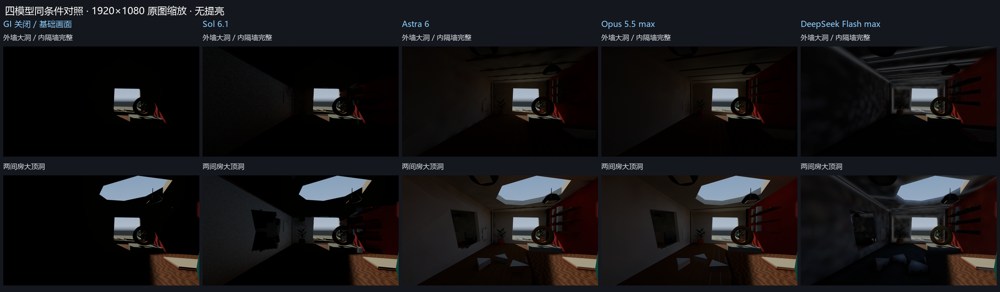

# 可破坏场景动态GI实现任务

## 一、题目构思与设计选择

### 1.1 需求来源与考核目标

这个题目主要构思于我之前做过的一段经历。我曾经在独自搭建和实现一款体素游戏时，磕它的动态gi更新系统磕了很久，也没做出一个能够称得上非常满意的结果。所以我就把当时这段经历拿来作为了这个题目。

这个系统的成果描述起来，就是建筑的墙壁或屋顶被破坏后，室外光照应沿新出现的开口进入室内，并经过表面反弹影响原先处于阴影中的区域；当开口被遮住、墙体被恢复时，相关的间接光也应随之更新。类似场景的难点在于，几何变化会同时改变遮挡关系和光的传播路径，系统需要在可交互的时间内给出新的光照结果。业内已有的成果最突出的可能就是类似The Finals游戏在gdc上做过的宣讲和最终游戏里的效果呈现。

因此，我希望考核模型的就是这么一套动态漫反射全局光照系统。模型需要把几何采集、光照输入、间接光求解、动态更新、历史处理和引擎渲染接入组成一个可以运行的整体，并说明其质量与运行成本。

### 1.2 给模型的问题

我通过搭建了一个Unity下的可破坏的测试场景，来作为提供给模型的基础工程。

在提供的 Unity 工程内，为现有测试场景实现动态漫反射 GI。场景由普通不透明三角网格构成，已经具备外墙、内隔墙、屋顶、室内家具、室外环境和固定光源。外部逻辑负责替换网格、启停碎片、移动遮挡板和恢复场景，模型实现的 GI 系统接收这些变化并更新结果。

主要要求如下：

1. 至少实现一次真实的漫反射间接光反弹，使没有受到太阳直接照射的接收面也能获得光照；天空输入需要经过遮挡判断，材质颜色需要参与光传输。
2. 支持网格替换、物体加入或移除、变换和重置。变化后应更新遮挡及间接光，旧光照不能因缓存未失效而长期残留。
3. 光照贡献不能仅因贡献表面离开屏幕而消失。需要检查相机变化、漏光、闪烁、边界伪影和历史拖影。
4. 提供独立 GI 开关，在相同几何、相机、曝光及光源条件下进行开关对照，并记录质量参数、变化响应和可测的性能成本。

GI 核心由模型自行实现，允许使用 GPU、Compute Shader、URP 扩展及 MCP 等开发工具。任务不指定路径追踪、探针或体素等具体路线，也不要求硬件光线追踪。禁止以 Unity 内置 GI、预计算光照或完整 GI 插件替代系统，禁止通过隐藏补光、按状态提高材质亮度或改变曝光代替光反弹。透明、蒙皮、体积散射和镜面焦散不属于本题必需能力。

### 1.3 基础工程与测试序列

基础工程提供场景、输入接口和测试操作，不提供 GI 求解器。模型无需制作房间、实现裂纹或开发物理爆破，可以将主要工作量用于 GI 系统。

测试采用同一场景中的七个状态：完整房间、外墙小洞、外墙大洞、打开内隔墙、小顶洞、两间房的大顶洞、恢复全部。另提供三类独立对照：只移动室外遮挡板；分别启用太阳、天空和室内灯；切换室内相机视角。

这组操作分别检查新光路产生、跨房间传播、较大范围更新、入口重新遮挡和历史消退。第一个状态与最后一个状态的几何相同，便于直接比较恢复结果。

## 二、评分规则及设计思路

### 2.1 权重设计

评分总分为 100 分，采用六个维度：

| 维度 | 分值 | 主要检查内容 | 权重设计理由 |
| --- | ---: | --- | --- |
| 可运行与工程接入 | 10 | 能否编译并在原场景运行，是否保留夹具含义，是否提供有效 GI 开关 | 运行是评价前提，但仅完成接入不能占据主要分数 |
| 光传输与视觉正确性 | 30 | 真实反弹、受遮挡的太阳及天空、材质染色、直接与间接光分离 | 对应 GI 系统最核心的功能，避免将整体增亮视为完成任务 |
| 动态更新与恢复 | 30 | 网格变化、碎片启停、遮挡板移动、跨房间更新及恢复后的缓存失效 | “可破坏”和“动态”是题目的主要区别，不能只考稳定状态 |
| 稳定性与观察一致性 | 15 | 相机变化、屏幕外贡献、漏光、噪声、接缝及边界伪影 | 反映系统在实际观察与交互中的可用性 |
| 性能与资源成本 | 10 | 更新峰值、稳定帧成本、响应时间、质量参数与资源规模 | 防止以无限计算换取单张好图，也允许合理的质量与性能取舍 |
| 证据与说明 | 5 | 对照图、条件记录、可复现方法、完成状态及已知限制 | 保证结果可以核对，同时避免文档数量压过实现质量 |

光传输和动态更新合计占 60 分，是因为这两项最直接对应原始需求。稳定性和性能用于区分“能够展示效果”和“能够持续交互”的系统。证据分值较低，但缺少证据会使某些功能无法获得充分确认，不能只依据实现说明中的自我评价给分。

### 2.2 如何判断完成程度

由于这是一个牵涉到了光照渲染系统和结果的模型任务。所以我更倾向于让agent本身进行评分，而不是code评分。虽然code评分确实可以将同一位置的不同画面根据PSNR等指标来进行对比，但是还是难以通过画面分析出当前系统的完成情况，以及背后实现和结果对于系统设计层面的意义。所以我还是交给了agent来评分。评分由Sol 6.1模型执行。

整体状态分为成功、部分完成和失败。成功指在约定的输入范围和近似精度内满足主要要求，且关键对照可以复现；部分完成指核心链路可以运行，但仍有明显功能、质量或动态响应缺陷；失败指无法运行，或没有实现需要考核的光传输和动态更新能力。分数进一步区分部分完成内部的成熟程度，因此较高分的原型仍可能被记为“部分完成”。

评分依据按实际运行结果、可复查代码和实现说明结合使用。画面用于判断表现，代码用于核对增亮来源及更新机制，文档用于说明输入范围和限制。纯代码检查不能替代运行验证；同样，一张效果图也不能证明系统支持一般网格和动态更新。

不同算法允许具有不同的内部精度和收敛方式，评价重点是相同外部条件下的行为。亮度均值仅用于描述响应幅度，不直接代表物理精度；CPU 提交时间、GPU 时间和受限帧影响的 FPS 也不能混为同一指标。缺陷应主要归入对应维度，例如重建引起的停顿计入运行成本，恢复后残留旧照明计入动态更新，避免因同一问题在多个维度重复重罚。

## 三、各模型完成情况与初步评分

四次实现从同一基础提交开始，分别保存在四个分支。统一复测中，四份提交都能运行，也都出现了与破口、遮挡和恢复相关的 GI 响应；但仍有不同程度的明显缺陷，整体先按部分完成记录。

| 分支与模型声明 | 完成状态 | 主要表现与不足 | 当前分数 |
| --- | --- | --- | ---: |
| eval1：Sol 6.1 | 部分完成 | 世界空间路径求交和动态失效链路成立；画面有明显黑边、块状缺失，相机变化后重新累积噪声 | 71/100 |
| eval2：Astra 6 | 部分完成，完成度较高 | 表面缓存稳定，能响应跨房间与遮挡变化；三角形接缝明显，拓扑重建成本较高 | 85/100 |
| eval3：Opus 5.5 max | 部分完成，完成度较高 | 光照连续性和整体表现较均衡，后续几何更新较轻；恢复时有短暂余辉及探针近似误差 | 88/100 |
| eval4：DeepSeek Flash max | 部分完成 | 体素化、光照注入、传播和恢复链路完整；存在光晕、模糊、材质处理和同步重建成本问题 | 73/100 |

下图展示相同视角与曝光下，外墙大洞及大顶洞两个状态的结果。左列为 GI 关闭的共同对照。各模型的细分得分、完整对照与测量口径见已有的[完整评测报告](评测报告.md)。

这四个结果都是由四个模型在同一基础项目上，给予相同的prompt后一轮产出的结果。可以看到，不同模型之间实现的表现还是存在不少差异。

## 四、设计和调整题目时遇到的困难，以及处理方法

### 1. 构造基础场景来详细测试gi效果

场景过于简单时，容易只看到开口上的直接光斑，难以观察间接光、染色和跨房间传播。增加家具、材质和装饰后，视觉信息变丰富，但如果室内补光过强，又会掩盖 GI 开关的差别。因此，场景美观与实验可解释性之间需要反复调整。

处理方法是保留适量模型和有色材质，同时将展示补光、室内灯、太阳和天空分开控制。正式评测关闭预览补光，隔离室外贡献时再关闭室内灯，固定室内相机和曝光。场景中同时保留容易看到的受光区域和阴影接收区域，使评审能检查光是否从受光面传播到了其他表面。

外部环境也作为光传输输入保留，而不只是背景贴图。题目不要求室内无条件变亮，而是要求照明随真实开口、遮挡和材质变化。这样能减少“好看”和“正确”被混为一谈的情况。

### 2. 区分各种照亮情况

这是评分设计中最关键的困难。太阳穿过破口，本来就会形成直接光斑；提高环境光或添加补光，也能让整间房看起来更亮。只展示破坏后的最终图，无法证明实现了 GI。即使存在天空照明，新增亮度也可能来自直接可见天空，而不是表面反弹。

因此，任务要求 GI 开关对照、太阳与天空分离、室内灯独立关闭，并检查阴影表面。仅太阳模式有助于观察受光表面的反弹；封闭、遮挡和恢复状态则帮助排除不受几何约束的填光。代码检查进一步确认贡献来自几何求解，而不是根据状态编号设置亮度。

目前的处理已经能排除多种明显替代做法，但仍有边界：没有独立高精度参考解时，不能从图片更亮或均值更大推导“更物理”。因此，本轮采用行为验证、图像观察和代码复查共同评价，保留对绝对光照精度的判断。

## 五、模型变强或过拟合后，如何调整评测

在该场景下，模型主要解决和搭建的是一套完整的光照系统。因此难以直接从得到的结果画面本身来反推拟合情况。而是需要测试各种条件下的gi效果。

当模型能够稳定完成当前七步时，可以保持任务定义和接口不变，扩展房间布局、开口位置、隔墙方向、墙厚、材质和光源方向。公开场景用于开发和理解要求，另外准备未见过的参数组合检验泛化能力。隐藏具体参数不等于隐藏需求：普通网格输入、可配置空间范围、更新事件和允许的材质简化仍应事先说明。

这能区分模型是在处理几何和光照，还是仅适配了某个固定房间。测试也应检查方案的配置要求，例如探针体或体素域允许按约定调整，不能把没有配置新空间范围与算法本身失败混为一谈。

而且，当前测试主要检查离散几何状态。更强的模型可以进一步接受连续移动的遮挡体、反复开关的多个开口、几何与灯光同时变化，以及相机运动期间的破坏。重点观察系统是否长期只能维持低质量首图、是否出现更新积压、缓存残留或内存持续增长。

这些测试应限制在事先声明的输入范围和合理负载内。增加难度的目标是检验更新调度、缓存失效和质量控制，而不是临时加入题目没有要求的透明、蒙皮或其他独立渲染能力。

## 六、这种造题方式是否可以批量化、规模化

我认为本题中可以复用的结构是：从真实开发需求确定一个系统边界，提供最小基础工程，以可控事件改变输入，再用正向、负向和恢复对照检查行为。这一结构能够批量生成同类测试案例，也可以迁移到其他运行时系统的任务设计中。

不过，生成一千个随机房间，并不等于创造了一千道独立问题。它们可能仍然只检验同一种能力。因此，规模化应以任务族为单位组织：先明确要考核的能力和典型失败模式，再为不同布局、材质、遮挡关系和更新类型生成案例。相近变体需要去重或分组统计，避免数量较多的简单变体主导总成绩。

| 环节 | 可自动化的部分 | 仍需审查的部分 |
| --- | --- | --- |
| 需求整理 | 根据模板列出输入、输出、约束和测试操作 | 是否来自真实工作，任务边界是否合适 |
| 基础工程 | 固定版本、生成布局和事件序列、保存参数与种子 | 是否包含足够可辨识的光路，是否泄露解法 |
| 案例预检 | 检查资源缺失、网格有效性、预定开口和基础遮挡 | 测例是否真的能区分不同实现 |
| 模型执行 | 从同一基础提交开始，记录模型、工具、预算和改动 | 人工介入和环境异常如何归因 |
| 结果采集 | 驱动状态、固定视角、保存图片、日志和元数据 | 画面异常是否来自采集过程 |
| 判分与复核 | 执行确定性检查、参考误差计算和统计 | 新型伪影、非预期但合理的解法、边界案例 |

## 七、其他想法

这个任务主要还是让agent通过coding实现了传统CG中的光照技术，搭建的也是真实的物理光照引擎。不过我认为，未来或许可以仅通过场景和光照数据来作为模型输入，画面作为模型输出，也就是AI渲染引擎。不过这似乎偏离了本题，就没有考虑进入。