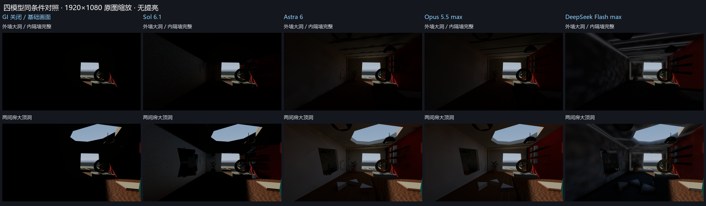
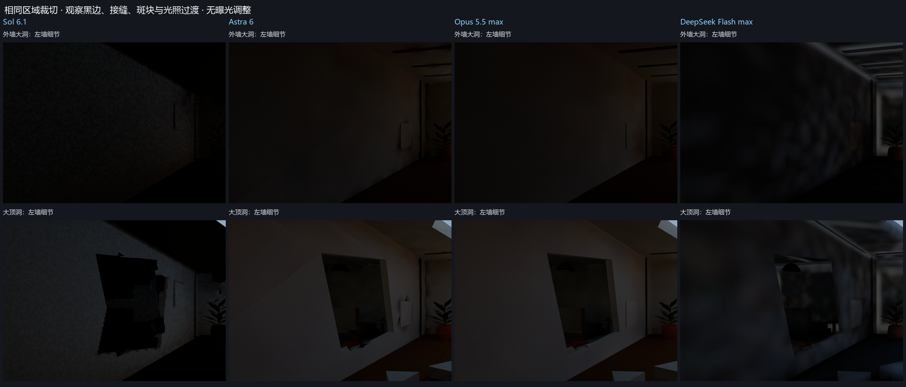
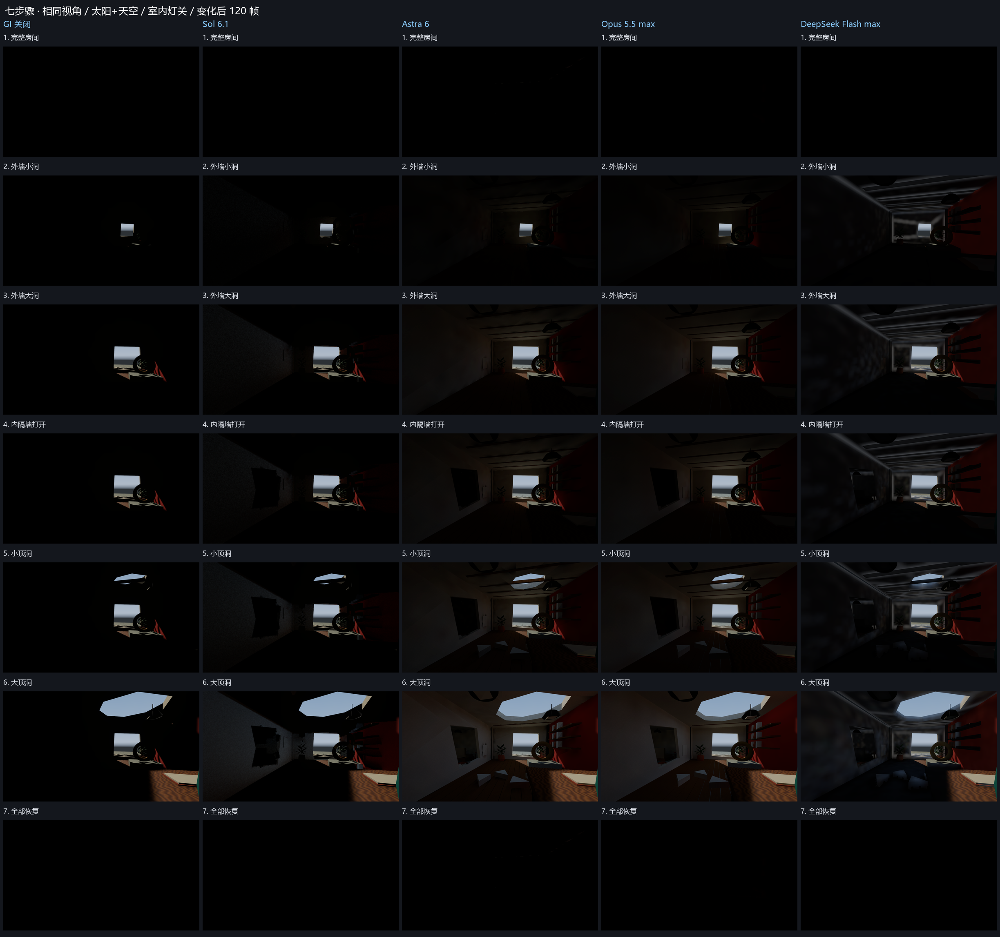
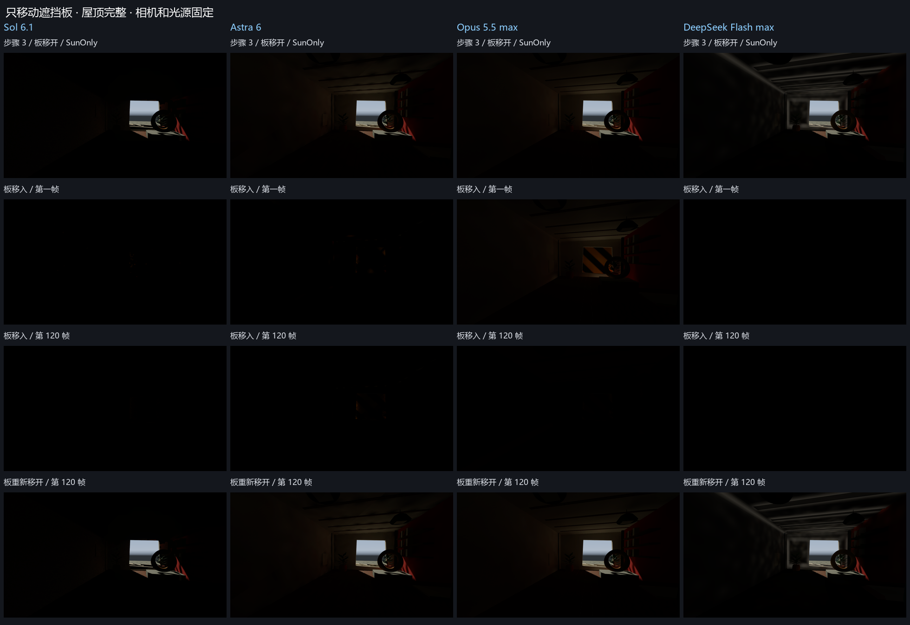
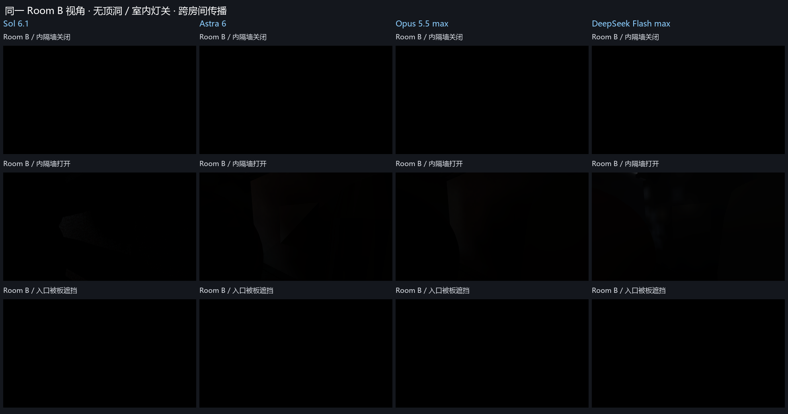
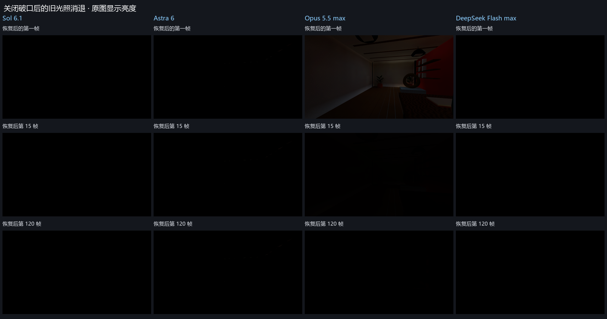
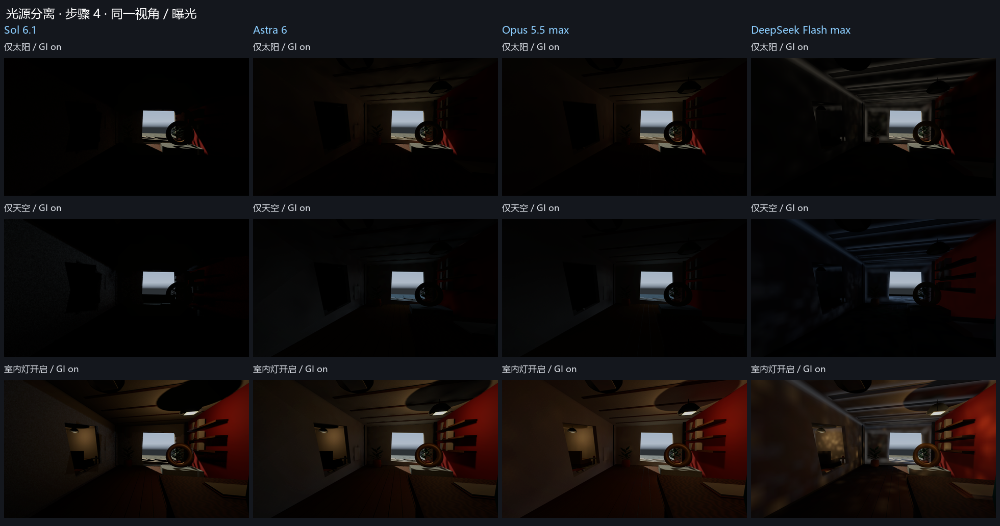
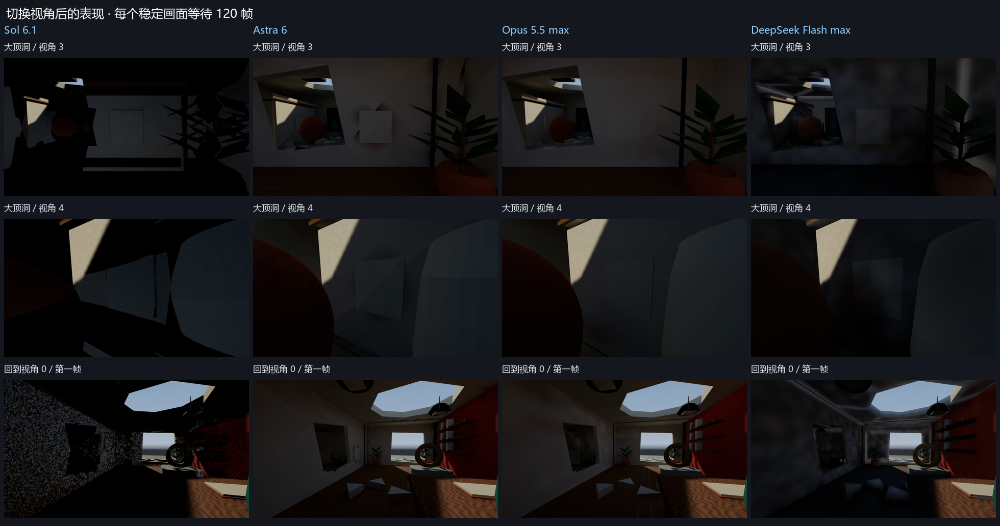

# 四模型动态 GI 工作结果评审

## 1. 样本与评审分

| 分支 | 提交 | 提交中声明的模型 | 方案 |
| --- | --- | --- | --- |
| eval1 | eb9b64e | sol6.1 | 480×270 图像接收采样；世界三角形 BVH 路径追踪；2 次命中 |
| eval2 | be724f5 | astra6 | 0.4 m 表面采样点；BVH 路径积分；最多 4 次反弹 |
| eval3 | 6883c64 | opus5.5 max | 两级 BVH + 细/粗世界空间探针；历史递推多次反弹 |
| eval4 | 83640ee | flash max | 0.1 m 表面体素；5 轮漫反射传播；连通性门控 |

四个分支都以 `d6180c3`（`eval-base`）为共同祖先；TASK.md 均未修改。原场景几何、相机、灯光和输入接口的含义保持一致。Opus 在场景中增加 GI 系统对象；Sol、Flash 增加 RendererFeature；Astra 通过接收面显示层接入。

本报告采用运行接入、光传输、动态更新、稳定性、性能、交付证据六项。分值是结合实测画面和代码的人工判断；同组几分的差距不宜作普遍模型排名。

| 模型 | 运行接入 /10 | 光传输 /30 | 动态更新 /30 | 稳定性 /15 | 性能 /10 | 证据 /5 | 评审总分 /100 |
| --- | --- | --- | --- | --- | --- | --- | --- |
| Opus 5.5 max | 10 | 27 | 26 | 12 | 8 | 5 | 88 |
| Astra 6 | 10 | 26 | 26 | 11 | 7 | 5 | 85 |
| DeepSeek Flash max | 10 | 22 | 24 | 8 | 6 | 3 | 73 |
| Sol 6.1 | 10 | 20 | 24 | 6 | 6 | 5 | 71 |

**优先继续完善 Opus；Astra 也是很有竞争力的基础。** 如果重视相机移动后的稳定缓存，二者都明显优于 Sol 的当前图像累积方案。如果重视破坏当帧无旧光残留，Astra 的立即失效处理比 Opus 更直接，但它的完整重建更慢。

## 2. 本轮如何保证对照成立

本轮实际依次打开四个分支，在同一台电脑、同一个项目中重新编译、进入 Play 并采集结果。四份提交均成功运行，采集器未记录到编译失败或运行异常。没有修改或修复模型的 GI 算法，没有创建新提交。

- 共 **308 张新 PNG 原图**，每份提交 77 张；每张均有同名 JSON，记录状态、相机、灯光、GI 开关、帧号、实际时间和最近重建耗时。完整逐帧证据及模型原有交付保存在项目外的原始评测目录；此处仅附报告使用的汇总图和核验数据。
- Unity 6000.5.4f1、URP 17.5.0、Direct3D 12、Linear 色彩空间、PC 质量级；RTX 4080 Laptop GPU（11995 MB），i9-13980HX，系统内存 32386 MB。
- 输出统一为 **1920×1080 sRGB PNG**，使用同一相机 RenderTexture 路径，不包含操作面板。曝光、材质、直接光照设置沿用夹具；无截图提亮、颜色修饰或生成式处理。
- 七步主比较使用 Room A 视角 0，位置 (-3, 1.7, 8.9)，FOV 72°；太阳加天空；室内灯关；L 预览补光关。各实现保持其提交默认质量参数和 GI 强度 1，没有强行设置成同一种内部精度。
- 变化后第 1、15、120 帧采图。主测试限帧 30，120 帧的实际记录时间约 4.1–4.2 秒；PNG 回读/编码会增加墙钟时间。这是共同观察预算，**不是对所有算法“完全收敛”的证明**。Sol 此时每像素 480 spp，Astra 已达到 1024 paths，Opus 持续更新探针，Flash 已完成 5 轮传播。
- **28 组七步 GI 关闭画面与共同对照逐像素一致（最大通道差 0）**，支持相机、基础光照和场景条件确实对齐。完整校验见 [condition_checks.csv](data/condition_checks.csv)。

原有截图没有直接混作横向评分：Astra 原记录器的七步使用 1280×720、SunOnly；其他记录的分辨率或输入不同。此次重新采集消除了这些差异。

## 3. 视觉效果：什么做到了，什么仍明显欠缺

### Opus：整体最均衡，动态历史仍有代价

阴影墙面、天花板、家具与碎片的 GI 比较连续，室内表面完整度较好，没有 Sol 那样大块的黑色缺失，也没有 Flash 那样明显的体素光晕。世界空间探针让贡献表面离开屏幕后仍能继续照明；两级 BVH 使本场景的后续几何重建较轻。它还支持室内灯的间接反弹。

主要扣分是**时间历史消退和低频斑块**。屋顶恢复后的首图仍保留明显旧照明；第 15 帧已显著衰减，第 120 帧接近初始黑图，但并非逐像素完全相同。静止和切换视角时仍有探针采样波动，0.4 m 细探针不能提供细几何的精确间接遮挡。当前只能称为完成度较高的动态 GI 原型。

### Astra：稳定缓存和通用几何方案扎实，三角形接缝突出

世界空间表面点求解完成后保留结果，相机移动不清空历史；天空、太阳以及跨房间变化都能复现。稳定画面的细小物体、屋顶边缘、接收面完整度明显好于 Sol。遮挡板平移可走局部 refit，成本较低。

主要扣分是**相邻三角形之间的光照不连续**：左墙上能看到三角形分界或大块插值斑纹；封闭房间仍有接缝残光。完整拓扑变化需要约 69–82 ms CPU 重建。稳定态求解停止，因此稳定态低开销不能代表连续破坏时的成本。室内灯的直接光保留，室内点灯的间接反弹未实现，这一点文档明确说明。

### Flash：链路完整、有限轮迭代响应快，但空间近似偏粗

实现了体素化、遮挡输入、天空注入、太阳与室内灯反弹、有限轮传播和恢复。移动外部板、屋顶变化、跨房间变化均能影响输出，稳定后停止传播计算。

主要扣分是**光晕、模糊和块状分布**：例如完好天花板的梁缘出现较强亮边，墙角和薄物体附近的 GI 不够贴合真实表面。0.1 m 体素、单体素法线/反照率和多轮邻域滤波会混合相邻面的信息。几何事件还包含同步回读与 CPU 泛洪，最近重建约 99–134 ms。

有两项需单独审查的代码行为：第一，无室内灯时会按**相机所在空气体素**是否连通室外来关闭整幅 GI。这基于几何，不能据此指控它按测试编号作弊；但封闭黑图本身不能独立证明内部体素传输无漏光，小于约 0.2 m 的通道也可能被保守封死。本轮标准视角的响应正确，更窄开口和相机接近边界未定量测试。第二，代码把几乎纯黑的反照率替换为 0.5 灰色，这会让真实黑色材质错误地反光；属于代码确认的材质输入缺陷，未在本轮另建黑材质场景做定量复现。

该分支的实现说明引用 `Reports/DynamicGI_Final`，但这些图没有进入 Git 提交；重建提交后的证据可携带性弱于其他分支，因此交付证据项扣分。本次独立重采结果完整保存，未把这项扣分算作算法错误。

### Sol：传输路径清楚，当前合成质量不足

以真正的世界三角形 BVH 求交，主射线接收面之外继续追踪反弹面，并对太阳做遮挡查询；光照贡献不局限于屏幕内。几何、光照变化清空累积，恢复与遮挡响应直接。它的实现说明、原始证据和测量局限交代得很完整。

主要扣分是**大块黑边、细物体缺失与颗粒**。480×270 的接收图与深度拒绝上采样，在破口、灯具、窗边、屋顶等区域出现明显不连续，稳定 120 帧后仍在。相机移动会清空图像历史，重新暴露噪声；它解决了屏幕外路径问题，但没有解决运动画面的稳定性。每次变化均全量重建，本轮约 40–43 ms；稳定后仍持续追踪。

代码审查还发现太阳反弹显式除以 π，而原 URP 同一灯光的漫反射直接项没有相同除数，存在输入单位匹配疑点。它比其他实现更暗不能单独当作“更物理”的证据。本轮未做独立白盒辐射度标定，因此不把该疑点写成经过参考渲染确认的误差倍数。室内点灯反弹未实现。

## 4. 破坏、遮挡和恢复的实测

### 七步骤的系统贡献

以下为全图 **GI 开 − 关** 的 Rec.709 加权显示亮度，单位是 0–255 显示码值。它能描述是否响应和响应幅度，**不是线性辐照度、反弹效率或物理精度分数**。部分系统的 GI 输出还包含经过遮挡的直接天空漫反射，因此不能把整张差图都称为纯反弹。仅太阳的独立对照用于进一步隔离太阳反弹。

| 状态：GI 开 − 关，显示亮度码值 | Sol | Astra | Opus | Flash |
| --- | --- | --- | --- | --- |
| 完整房间 | 0.000 | 0.005 | 0.001 | 0.000 |
| 外墙小洞 | 0.860 | 2.625 | 2.752 | 7.477 |
| 外墙大洞 | 2.929 | 7.661 | 7.344 | 9.091 |
| 打开内隔墙 | 2.378 | 6.950 | 6.714 | 8.896 |
| 小顶洞 | 3.588 | 10.174 | 9.949 | 9.650 |
| 大顶洞 | 7.569 | 16.754 | 16.947 | 13.098 |
| 恢复 | 0.000 | 0.005 | 0.002 | 0.000 |

四份在新开口产生后均增加阴影表面的照明，大顶洞产生更广范围变化。Flash 的外墙大洞图比 Opus/Astra 更亮，但光晕也更强；不能据亮度数值给它更高的物理正确性评价。完整七步见下图。

### 外部板只移动位置

步骤 2、3、4 都做了 SunOnly 下的开 → 遮 → 再开，保持屋顶完整、相机和光源不变。四份都出现间接照明减少并恢复。Sol 和 Astra 遮挡后的全图均值仍有极弱残留，远小于打开状态；Opus 首图保留旧历史，后续消退；Flash 首份输出即明显清除。

### 内隔墙打开是否真的影响第二间房

补充测试把相机固定在 Room B 视角 4，外墙大洞、屋顶完整、室内灯关，先保持内隔墙关闭，再打开，最后盖住室外入口。

| Room B 固定视角，GI 开 − 关 | Sol | Astra | Opus | Flash |
| --- | --- | --- | --- | --- |
| 内隔墙关闭 | 0.000000 | 0.000000 | 0.000000 | 0.000000 |
| 内隔墙打开 | 0.213132 | 1.166171 | 1.051832 | 2.048657 |
| 入口被遮挡板盖住 | 0.000001 | 0.000000 | 0.000000 | 0.000000 |

四份都符合“内墙完整时几乎没有这一路贡献，内墙打开后增亮，入口遮住后又消退”的方向。**第二间房整体仍很暗**。当前结果支持跨房间传播存在，不能声称已经得到《The Finals》那种强烈、完整、稳定的室内照明观感。Flash 的增量较大，同时空间伪影明显；缺少参考解时，不将更大数值视作更准。

### 恢复时的旧光照消退

下表为恢复状态的全图平均显示亮度，括号内是从操作到该记录的实际时间，包含采集开销。相同条件下 GI 关闭图为黑。第 1 帧意为变化后的首个完整测试帧，不等于瞬时零延迟。

| 模型 | 恢复后第 1 帧 | 第 15 帧 | 第 120 帧 |
| --- | --- | --- | --- |
| Sol 6.1 | 0.0000（0.10 s） | 0.0000（0.59 s） | 0.0000（4.12 s） |
| Astra 6 | 0.0050（0.16 s） | 0.0052（0.67 s） | 0.0053（4.19 s） |
| Opus 5.5 max | 13.8145（0.10 s） | 0.5073（0.59 s） | 0.0019（4.12 s） |
| DeepSeek Flash max | 0.0000（0.15 s） | 0.0000（0.64 s） | 0.0000（4.18 s） |

Opus 的首图余辉最明显；约 0.59 s 时已很弱，约 4.12 s 时接近黑。恢复图与初始图的平均 RGB 绝对差约 0.00135/255，最大通道差 2/255。Astra 初始与恢复图逐像素一致，但二者都保留同样的细接缝残光；不能把“恢复一致”误当作“没有漏光”。Sol 和 Flash 本轮的初始与恢复图相同。

## 5. 光源分离与相机变化

本轮记录了 SunOnly、SkyOnly、SunAndSky 的同条件 on/off，以及室内灯开启对照。四份都能响应室外输入变化。Sol/Astra 仅保留室内灯直接光，Opus/Flash 也计算其间接项；这是支持范围差异，本题并未明确要求点灯反弹必须实现，不按缺少该扩展单独判失败。

本轮还在大顶洞状态切换视角 0 → 1 → 3 → 4 → 0。世界空间贡献仍存在。Sol 回到原视角时重新累积，首图噪声明显；Astra 复用表面缓存；Opus 复用并继续更新世界探针；Flash 复用体素场。本轮没有在连续自由飞行中录制完整逐帧视频，因此只对这些离散切换与已有首图作结论。

## 6. 成本：区分稳定帧与变化帧

| 模型 | 步骤 2–7 最近重建 CPU ms | 遮挡板最近更新 CPU ms | 稳定 GI 开：帧间隔 ms | GI 关：帧间隔 ms | 再开 GI：帧间隔 ms |
| --- | --- | --- | --- | --- | --- |
| Sol 6.1 | 40.03–43.27 | 40.32–41.27 | 11.25 | 2.63 | 11.26 |
| Astra 6 | 69.36–81.99 | 0.19–4.48 | 2.78 | 3.24 | 3.18 |
| Opus 5.5 max | 3.54–4.17 | 3.21–3.84 | 5.87 | 3.09 | 5.82 |
| DeepSeek Flash max | 99.47–134.43 | 103.55–126.36 | 2.41 | 2.45 | 2.93 |

重建列来自提交实现公开的主线程 Stopwatch 指标，是实现自己定义的墙钟区间；Flash 包含同步 GPU 回读等待，不能解释成纯 CPU 执行指令的时间。**这些区间不等于独立 GPU 时间，也不一定覆盖整个变化帧**。拓扑列只列步骤 2–7，未混入启动预热；Opus 本轮最初一次完整构建约 48 ms，不能只报后续 3–4 ms 而遗漏首次成本。遮挡板列取步骤 2–4：Astra 的较低成本与其局部 refit 一致；Sol/Flash 全量更新较重。

后三列是本轮在相同 1080p 手动渲染路径中，取消限帧后各 90 帧窗口、剔除前 5 帧得到的 **Editor LateUpdate 墙钟帧间隔中位数**。CPU/GPU 可以重叠，窗口还受编辑器调度、频率与提交影响；不是 Player 帧率，不是单独 GI GPU pass。Astra 的开窗口甚至比关窗口略短，说明这种小差值低于本轮调度噪声，不能得出“负开销”。Flash 的两个开窗口也不同，不能把某一个差值声称为零成本。

稳态 Astra 和 Flash 已停止求解，只保留接收层/合成；Sol、Opus 仍持续更新。因此稳态帧间隔不能单独决定动态系统优劣，必须同时看重建和再次收敛的代价。各提交文档还有 GPU 分项和内存自报数据，但口径不同，本轮没有重新取得可独立归因的逐 pass GPU 时间或真实显存峰值，不混成一张精确性能排行榜。

原始窗口汇总见 [frame_intervals.csv](data/frame_intervals.csv)。逐张图的实际等待时间和重建读数见 [image_metrics.csv](data/image_metrics.csv)。

## 7. 对任务完成度的判断

**可以作为较好的答案：Opus、Astra。** 它们都跨过了“破口直射光斑演示”的阶段，能把太阳与天空通过实际几何路径带入室内阴影，并响应隔墙、屋顶、遮挡板及恢复。Opus 更接近持续运行、可移动相机的动态 GI 系统；Astra 的稳定缓存方案更直接，但要继续解决三角形连续性与拓扑重建峰值。

**完成主要功能但需要明显返工：Flash、Sol。** Flash 优先修复接收材质、体素法线/滤波的空间错误，并验证连通性门控在更细几何中的行为。Sol 优先修复深度感知合成导致的黑色缺失、运动历史处理，以及太阳单位匹配。直接把稳定截图调亮不能解决这些问题。

四者都没有独立高精度参考渲染，不能给出可证实的物理误差排名。普通网格替换、碎片启停、板平移和重置已由夹具覆盖；本轮没有另建任意网格压力场景，没有重做所有历史文档中的独立 donor color 实验，没有测试 Player、其他硬件、透明/蒙皮或持续高频破坏。颜色染色的判断结合当前画面和代码，原有定量测试属于提交证据，不能冒充本轮独立复核。

如果把这份材料用于最初的评测交付，结果图片、完成状态、评分依据和局限现已具备；“每次设计/调参遇到什么困难、如何克服、是否有人介入”仍需依据原始对话记录补充，不能从最终代码逆推成真实开发过程。

## 8. 配套材料

- [总览](figures/overview.png)、[七步全览](figures/seven_steps.png)、[细节](figures/detail.png)、[遮挡板](figures/blocker.png)、[恢复](figures/restore.png)、[跨房间](figures/crossroom.png)、[光源](figures/sources.png)、[相机](figures/offscreen.png)。拼图仅缩放或裁切并添加标签，图像亮度未修改。
- [条件一致性核验](data/condition_checks.csv)、[帧间隔记录](data/frame_intervals.csv)、[图像指标](data/image_metrics.csv)及[代码审查依据](data/code_review.md)。

本目录保留两份报告直接使用的展示图片与核验文件。完整原图、逐帧 JSON、历史证据和采集工具保存在项目外的原始评测目录。
